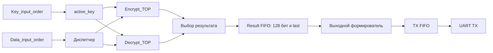

# Архитектура ускорителя «Кузнечик»

Состояние RTL и проектные решения на **8 ноября 2026 года**. Устройство — Artix-7 `xc7a100tcsg324-1`, проект Vivado 2022.2.

## Рисунки структуры

- Эскиз тракта с FIFO результатов. [PNG](architecture/cpu-peripheral-interaction-with-result-fifo.png)
- Исходный общий рисунок ускорителя. [PNG](accelerator-architecture.png), [SVG](accelerator-architecture.svg)

Рисунки фиксируют предыдущие варианты схемы. Текущие решения по загрузчику и кнопкам описаны в [тракте приёма](SYSTEM_BUS_AND_PROGRAMMER.md), а состав вычислительного тракта приведён ниже.

## Тракт приёма и управление

UART RX передаёт в RX FIFO слово из восьми бит данных и двух флагов ошибок. После FIFO арбитр направляет поток в загрузчик программы либо в рабочий тракт. В рабочем тракте CPU через регистр выбирает получателя `KEY / DATA / PAUSE`. В режиме загрузки аппаратный загрузчик записывает инструкции в память программ. CPU получает инструкции из этой памяти и обращается к статусам и конфигурации через системную шину.

Кнопка загрузки запрашивает смену владельца RX-потока. Кнопка ENC/DEC запрашивает смену режима вычисления. Условия применения на границах кадров и настройки периферии через регистры описаны отдельно. [Загрузчик и системная шина](SYSTEM_BUS_AND_PROGRAMMER.md)

## Тракт вычисления и ответа

Диспетчер резервирует место под результат перед запуском, поскольку вычислитель выдаёт `result_valid` без обратного `ready`. Для каждого запуска суммарное число занятых записей и ожидаемых результатов должно укладываться в действующую ёмкость FIFO. Результат хранится вместе с `last` и передаётся выходному формирователю по `valid/ready`.

События «последний результат ядра» и «последний байт физически передан по UART» различаются. Первое разрешает смену активного ключа при соблюдении правил допуска. Второе нужно для завершения ответа и, в первом варианте, для безопасного применения нового режима, если формат вывода зависит от общей настройки.

## Что уже есть в RTL

- **UART_TOP.** RX/TX, синхронизатор, делитель и счётчики. По умолчанию `FREQ=100_000_000`, `BAUDRATE=1200`, `RATIO=8`. Формат 8E1. Приёмник выдаёт `TX_DATA[9:0]` и `TX_VALID`; передатчик принимает `RX_DATA[7:0]` по `RX_VALID && RX_READY`. При переполнении RX FIFO нужна обработка ошибки на системном уровне. [UART_TOP.v](../CourseLab.srcs/sources_1/UART_TOP.v)
- **FIFO.** Два clock, запись по `write_enable && !full`, чтение по `read_valid && read_ready`. Единый модуль подходит для RX, TX и результатов. [Контракт FIFO](FIFO.md)
- **Key_input_order.** Разбирает 64 HEX-символа с CRLF и удерживает результат до `key_ready_receiver`. Корректность отмечает `key_noerr`. [Key_input_order.v](../CourseLab.srcs/sources_1/Key_input_order.v)
- **Data_input_order.** Собирает байтовые блоки ENC, распознаёт CRLF, добавляет `0x80` и нули и удерживает блок с `packet_last` до `packet_accept`. HEX-ввод и отдельные правила DEC остаются в плане. [Data_input_order.v](../CourseLab.srcs/sources_1/Data_input_order.v)
- **Encrypt_TOP.** Принимает 128-битный блок, ключ и `last` по handshake. Шифрование подтверждено симуляцией за 35 тактов. [Интерфейс и расписание](ENCRYPT_TOP.md)
- **Decrypt_TOP.** Принимает шифротекст и исходный ключ по тому же интерфейсу. В отдельной симуляции подтверждены обратные раунды и результат через 43 такта. [Дешифратор](DECRYPT_TOP.md)
- **Выходной формирователь.** `Create_output_order` пока заготовка. Сериализацию, HEX-вывод, правила окончания сообщения и снятие дополнения DEC предстоит реализовать. [Create_output_order.v](../CourseLab.srcs/sources_1/Create_output_order.v)

Для общей системы остаются аппаратный `active_key`, загрузчик, CPU и шина, маршрутизация RX, диспетчер, системные экземпляры очередей, обработка формата DEC, выходной формирователь и системный top. Многоблочный режим, формат сообщения и реакцию на позднюю ошибку нужно согласовать до сквозной сборки. [План проекта](NEXT_STEPS.md)

## Vivado и ограничения

`sim_1` связан с `sources_1`. Для конкретной симуляции выбирается соответствующий TB как Simulation Top. Скрипты отдельной симуляции перечислены в [контексте](CONTEXT.md).

`constraints.xdc` задаёт окружение эксперимента L. `uart_board.xdc` ожидает порты платы `CLK` (E3), `SYS_NRST` (C12), `UART_RXD` (C4) и `UART_TXD` (D4), такт 100 МГц и LVCMOS33 для указанных выводов. Эти ограничения следует согласовать с итоговым системным top. Распределение clocks, CDC, WNS/hold и проверка платы входят в финальную аппаратную приёмку. [Ограничения L](../CourseLab.srcs/constr_1/constraints.xdc), [ограничения UART](../CourseLab.srcs/constr_1/uart_board.xdc)
