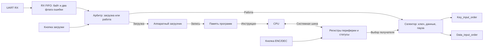

# Загрузка программы CPU и настройка периферии

Решение по архитектуре от **8 ноября 2026 года**. Цель — загружать программу CPU и менять рабочие настройки уже настроенной FPGA. Ниже описаны выбранные роли, совместимость текущих модулей и вопросы для согласования перед RTL.

## Два тракта после RX FIFO

- **Режим загрузки.** Арбитр направляет принятые слова в аппаратный загрузчик. Тот разбирает кадр загрузки и записывает инструкции в память программ. На время записи выполнение CPU приостановлено. Загрузчик и вход в этот режим работают независимо от программы CPU.
- **Рабочий режим.** CPU через системную шину выбирает `KEY`, `DATA` или `PAUSE`. Аппаратный селектор направляет слова из FIFO в соответствующий формирователь. `PAUSE` оставляет слова в очереди.
- **Роль CPU.** CPU получает инструкции из памяти программ и читает статусы периферии по шине. Байты UART идут через FIFO к загрузчику или формирователям. Готовый корректный исходный ключ поступает в `kuz_key_loader`, а собранные блоки данных — к диспетчеру вычислителя.
- **Три разных выбора.** Кнопка загрузки определяет владельца потока `LOAD / WORK`. CPU выбирает назначение ввода `KEY / DATA / PAUSE`. Кнопка ENC/DEC запрашивает режим вычисления. Формат кодирования данных, например ASCII или HEX, задаётся отдельно.

Арбитр и селектор здесь описаны как две логические ступени. Физически их можно собрать в одном блоке маршрутизации с одним `read_ready` для FIFO.

## Кнопки и границы переключения

**Согласовано.** Вход в загрузку происходит по нажатию кнопки. ENC/DEC тоже выбирается кнопкой. У каждой кнопки нужен синхронизатор, подавление дребезга и одно событие на нажатие.

**Предложение для первой версии.** Нажатие фиксирует запрос. Переход выполняется после завершения текущего обмена либо после явно согласованной отмены. Если запрос пришёл в середине кадра, текущий потребитель доводит кадр до границы. ПК отправляет новый кадр после признака готовности выбранного режима. Для выхода из загрузки предлагается явная команда запуска после проверки программы. После запуска рабочий маршрут начинает с `PAUSE`, пока CPU не выберет получателя.

Переход `KEY ↔ DATA` привязан к границе ввода и обработке результата формирователя. `TX_READY` показывает возможность принять очередное слово. В `Data_input_order` состояние `IDLE` используется и при частично собранном блоке. Для безопасной смены маршрута понадобится отдельный признак завершения ввода или явный протокол, который гарантирует границу кадра.

Для ENC/DEC активный режим фиксируется на всё сообщение. В первой версии можно применять запрос после завершения предыдущего ответа, пока выходной формирователь использует общую настройку режима. `busy_all_message` отражает обработку сообщения в выбранном ядре. Обновление ключей разрешается после последнего результата с `last=1`. При одновременном запросе приоритет у принимаемого блока данных.

## Совместимость текущей реализации

- **UART RX и FIFO.** `UART_TOP` выдаёт `TX_DATA[9:0]` и `TX_VALID`. Для RX подходит экземпляр существующего FIFO с `WORD_SIZE=10`, его вход записи получает импульс `TX_VALID`. Чтение уже предоставляет `data_out`, `read_valid`, `read_ready`. На RX UART обратного `ready` нет, поэтому при `full` новый байт может потеряться. Нужны статус переполнения и протокол, при котором ПК выдерживает паузы или отправляет порции по подтверждению. При переполнении кадр загрузки следует считать ошибочным. [UART_TOP.v](../CourseLab.srcs/sources_1/UART_TOP.v), [FIFO.v](../CourseLab.srcs/sources_1/FIFO.v)
- **Маршрутизация.** `read_ready` берётся только от выбранного получателя. Его входной `valid` равен `read_valid` при выбранном маршруте. Остальные получатели видят `valid=0`, а в `PAUSE` FIFO получает `read_ready=0`. Слово считается переданным на фронте `read_valid && read_ready` и может быть принято только одним получателем. Флаги ошибок сохраняются до загрузчика или формирователя. Переключение владельца привязывается к протоколу кадра, а не только к сигналу `empty`. В текущем FIFO `empty` показывает отсутствие подготовленного выходного слова. [FIFO.v](../CourseLab.srcs/sources_1/FIFO.v)
- **Ввод ключа.** `Key_input_order` принимает те же 10 бит по `TX_VALID && TX_READY`. Разобранный результат удерживается до `key_ready_receiver`. Получатель должен обработать `key_valid` даже при `key_noerr=0`, чтобы освободить формирователь, сохранив действующий ключ. Активный банк и допуск обновления реализованы в `kuz_TOP`. Предстоит соединить `Key_input_order` с `kuz_key_loader` и обработать `key_noerr`. [Key_input_order.v](../CourseLab.srcs/sources_1/Key_input_order.v), [ТЗ, раздел 1.5](KUZNYECHIK_TZ_AND_L.md#15-занятость-сообщением-и-аппаратная-смена-ключа)
- **Ввод данных.** `Data_input_order` тоже принимает 10-битный поток с `TX_VALID/TX_READY`. Он уже собирает байтовые блоки ENC и удерживает `packet`, `packet_noerr` и `packet_last` до `packet_accept`. HEX-ввод и поведение DEC ещё предстоит определить и реализовать. Порт `mode` в обоих формирователях сейчас не используется. Назначение получателя задаёт внешний селектор. [Data_input_order.v](../CourseLab.srcs/sources_1/Data_input_order.v)
- **Шифратор.** Диспетчер сможет передавать `packet` и `packet_last` в `kuz_TOP` по `data_input_valid && data_input_ready`, когда готов набор раундовых ключей и место под будущий результат. `packet_accept` должен подтверждать фактический приём блока либо явно согласованную обработку ошибки. Выход ENC выдаёт результат без `ready`, поэтому место в FIFO результатов резервируется перед запуском. [Encrypt_TOP.v](../CourseLab.srcs/sources_1/Encrypt_TOP.v)
- **Новые блоки.** В текущих исходниках отсутствуют системная шина, регистры конфигурации, CPU, память его программ, загрузчик и общий арбитр. Формат загрузочного кадра, размер инструкции, способ запуска и карта адресов пока открыты.

Таким образом, для маршрутизации подходят существующие потоковые интерфейсы. Смена владельца, загрузка программы и конфигурация через шину добавляются как системная логика. Готовность отдельных модулей подтверждена прежними проверками. Совместимость всей схемы пока оценена по RTL и контрактам.

## Настройки во время работы

Процессор пишет рабочие значения в регистры по системной шине. Разрядность физической шины, объём памяти и допустимые пределы закладываются в битстрим. Для каждого регистра нужно определить начальное значение, диапазон, условия применения и способ узнать результат записи.

- **UART.** Сейчас `DIV_VALUE` вычисляется из `FREQ`, `BAUDRATE` и `RATIO` при сборке. В будущем рабочий делитель можно брать из регистра `UART_DIV`. Новое значение применяется между кадрами при свободных RX и TX, с согласованием скорости на стороне ПК. Для режима загрузки нужна известная скорость, доступная независимо от настроек программы. [UART_TOP.v](../CourseLab.srcs/sources_1/UART_TOP.v), [KM_CLK_DIVIDER.v](../CourseLab.srcs/sources_1/KM_CLK_DIVIDER.v)
- **FIFO.** `FIFO_DEPTH` задаёт физическую память и ширину указателей. Программируемый лимит задаёт допустимое число занятых записей в пределах этой памяти. Для первой версии менять лимит на пустой очереди без зарезервированных записей. Физический обход адресов сохраняется, а при допуске шифрования учитывается действующий лимит FIFO результатов. [FIFO.v](../CourseLab.srcs/sources_1/FIFO.v)
- **Длина слова.** Физическая ширина остаётся заданной при сборке. Регистр может задавать число значащих битов или формат кадра, если обработчик поддерживает этот диапазон. Например, изменение длины слова UART потребует поддержки в обоих автоматах RX/TX. Блок «Кузнечика» остаётся 128-битным.
- **Системная шина.** Для первого варианта достаточно CPU как инициатора обращений и регистров периферии как адресуемых получателей. Определить адрес, направление, данные записи/чтения и подтверждение. Для настроек, применяемых на границе кадра, различать принятую запись и фактически действующее значение. Если загрузчик пишет в память программ при остановленном CPU, делить с CPU системную шину для этой записи необязательно.

## Следующий шаг проектирования

1. Описать последовательность от кнопки загрузки до запуска CPU: состояние рабочего тракта при входе, готовность загрузчика, границы кадра, проверки записи и команда запуска.
2. Зафиксировать контракт арбитра: маршруты `LOAD / KEY / DATA / PAUSE`, источники выбора, подтверждение и условия переходов. Определить, как CPU и ПК договариваются о том, что следующим поступит ключ или сообщение.
3. Описать минимальную транзакцию системной шины и два первых регистра: выбор `KEY / DATA / PAUSE` и рабочий `UART_DIV`. Статусы и запрос ENC/DEC выделить отдельно от маршрута ввода.

Критерий согласования схемы: кнопка переводит плату в загрузку, кадр попадает в память программ, а запущенный CPU выбирает получателя ввода и может изменить рабочий делитель UART с тем же битстримом. При смене режима слова предыдущего кадра сохраняют своего получателя. Проверки отдельных блоков и системная интеграция остаются разными этапами.
